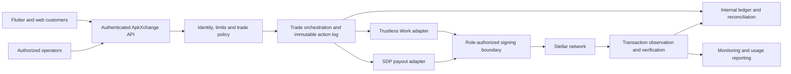

# ApkXchange Trade Rail: Stellar architecture

Last updated 3 October 2026, with a product update added 24 November 2026. This is how we plan to build the integration for the SCF Integration Track; it isn't live on mainnet yet. Our CTO and I still need to sign off on the signing setup and confirm each component works with it before this becomes our final submission architecture.

## What we're building on

We're bringing Stellar USDC settlement, Trustless Work escrow and the Stellar Disbursement Platform (SDP) into the gift-card, wallet and P2P experiences ApkXchange already has. USDC on Stellar is the first funded rail. Other assets, swaps and fiat corridors need their own technical and commercial checks, so they're not part of this first commitment.

Our Flutter and web apps, identity checks, trade workflows and internal ledger are the foundation. We already have wallet holds, ledger postings, trade-state checks and a managed dispute process. We'll adapt and test all of these against a real onchain escrow, and we will never show an internal ledger hold to a customer as if it were a funded Trustless Work escrow.

Collecting and paying out cedis stays a separate payment flow. SDP sends Stellar assets to supported recipients; it doesn't convert to GHS or RMB. We're not launching a token.

### Our on/off-ramp update

Our upcoming release lets customers buy stablecoins with cedis and sell them back to cedis inside ApkXchange, next to gift-card trading. It turns ApkXchange into a gift-card and stablecoin fintech, and it gives the Stellar rail real customer demand from day one: people already moving between cedis, stablecoins and gift cards with us. The on/off-ramp is built and funded by ApkXchange; this SCF request covers only the Stellar escrow and disbursement work below.

## How it will work for customers and our team

**Stellar disbursements:** We want Stellar USDC payouts available to every customer who passes verification and completes supported wallet onboarding. Customers pick this payout option on eligible transactions and see the confirmed status in their account. That doesn't mean every external wallet will work; we'll confirm the supported recipient route during the integration.

**Transaction authorization:** Our backend checks the customer, recipient, asset and amount before it authorizes anything through a protected signing service. Signing keys never live in the mobile or web apps. During the integration we'll confirm the signing setup we choose handles both Stellar transactions and Soroban authorization.

**P2P escrow:** USDC sits in a Trustless Work escrow until both sides have done what they agreed. Release needs the approval of the designated participant. If there's a dispute, we review the evidence through a documented process and resolve it through the authorized contract roles. Our ledger only settles once the result is confirmed onchain. We'll test the resolution and refund paths against the exact contract version we use.

## Components

Our API authenticates the user, checks ownership and policy, and records what it intends to do before anything is submitted. Signing sits behind its own boundary: apps and ordinary requests never get platform signing keys. We haven't picked the final signer yet. Whatever we choose has to handle Stellar transactions and Soroban authorization for both integrations, and we're not assuming our current custody provider supports this.

## Accounts, assets and transactions

The rules we're building to:

- We treat network, asset code and issuer (or contract) as one allowlisted asset. Testnet and mainnet each get their own configuration, keys, accounts and records.
- We check recipient addresses, required routing identifiers and asset acceptance before payout. We set up trustlines, or supported contract-wallet handling, wherever our account model needs them.
- Before signing, we check network, contract, operation type, destination, asset, amount, fee ceiling and required role against the approved application intent. We never sign XDR handed back by an API without checking it.
- We store intent IDs and transaction references, serialize conflicting account submissions and reconcile uncertain submission results before retrying. A timeout doesn't mean the transaction failed.
- We only credit or settle ledger entries after independently observing a successful transaction on the correct network. A browser callback, a screenshot or a provider's status message is never enough on its own.

## Trustless Work escrow

We'll start with a single-release escrow for a trade settled in one payment. Trustless Work works with roles, so we have to map our buyer and seller to those roles explicitly:

| Component role | Proposed application mapping | Validation required |
|---|---|---|
| Service Provider | The participant delivering the agreed offchain payment obligation | Confirm action/signing support for the chosen customer account model |
| Approver | Participant entitled to confirm receipt of that obligation | Confirmation must refer to actual receipt, with a dispute route |
| Receiver | Intended USDC beneficiary | Match trade party and approved destination |
| Release Signer | Separately authorized settlement signer | Verify approvals, current escrow state and exact transfer intent |
| Dispute Resolver | Designated resolution signer under governed operator workflow | Require recorded evidence, decision and separate approval |
| Platform Address | ApkXchange platform role and disclosed fee destination if used | Configure only approved permissions and disclosed fees |

This mapping is our plan, and we'll confirm it with integration tests and with the Trustless Work team. Separating approvals in our app doesn't mean the contract itself requires several operator signatures, so our signing policy has to enforce that.

The flow: create a trade and operation intent; deploy the escrow with validated asset, amount, receiver and roles; submit funding; observe confirmed funding; enable the offchain payment stage; record receipt confirmation or dispute; submit the role-authorized release or resolution; observe the resulting transfer; then settle the internal ledger exactly once. A local deadline may trigger review, but cannot imply an automatic onchain refund. Cancellation/refund paths must use actions supported by the selected contract version and state.

Our ledger tracks money held in escrow separately from money the platform holds freely. Funding, release and refund must never double-count a customer's credit or what we owe. Failed or uncertain operations stay visible to our operators until someone resolves them.

## Stellar Disbursement Platform

We'll use SDP for approved payout batches through a supported recipient onboarding route. We won't claim payouts to any wallet until we've checked which recipients actually work. Our controls: check the beneficiary, one operator prepares the batch, a second approves it, distribution signing is restricted, and every recipient is reconciled.

We record batch and recipient IDs and transaction references, watch each payment's result, and only retry payments we've proven safe to retry. The messages customers get during onboarding and delivery will describe the process honestly. An SDP payout is funded on its own; it doesn't pull money out of a Trustless Work escrow or convert it to cash.

## Security and failure handling

Customer documents, gift-card codes and payment evidence stay in our protected storage and never go onchain. Public reporting shows transaction references and totals, never identities or which account belongs to whom.

What we'll build and test: participant authorization; role/signature checks; stale-state protection; immutable decision history; duplicate and out-of-order event handling; transaction-intent integrity; asset/network validation; deployment separation; approved signing limits; and reconciliation of customer liabilities against platform and escrow assets without counting either twice.

In tranche 2 we'll write a threat model covering malicious participants, account takeover, operator misuse, leaked integration keys, fake settlement notifications, signature substitution and reconciliation failures. Our monitoring plan names who responds, and how, to stuck escrows, unexpected signing, failed payout batches, balance mismatches and unusual transaction patterns. If we pause the system, new risky actions stop but we can still watch and recover escrows that are already funded.

## What we'll show at each stage

1. MVP: architecture decisions, signer compatibility, complete escrow lifecycle demonstrations, asset validation and duplicate/failure tests.
2. Testnet: integrated customer/operator journeys, supported SDP recipient payouts, ledger reconciliation, threat model, monitoring and recovery exercises.
3. Authorized mainnet: readiness evidence, registered accounts/contracts, controlled external use and reproducible reporting against the agreed threshold/window.

Our main measure is settled USDC payment volume from real external users attributable to registered ApkXchange onchain accounts/contracts. We count each payment once, so funding an escrow, releasing it and later paying out the same money can't inflate the total. We leave out test and team transfers, loops, failed payments and anything artificial, and we report refunds and exclusions. Our target is at least $10,000 in genuine settled USDC payments from external users over 14 consecutive days, roughly 14–27 March 2027, if the SCF panel agrees. The dates depend on funding confirmation and agreement with SCF.

## What we still need to decide

Before we submit, our technical team will confirm the signing and account setup, how participant roles work, which dispute and refund paths are supported, the SDP recipient model, how we independently observe transactions, and how escrow shows up in our ledger. We'll also confirm launch requirements and name who owns each part of operations. We're not claiming live Stellar functionality on mainnet, partner approval or completed licensing.

## References

- [SCF Integration Track](https://stellar.gitbook.io/scf-handbook/scf-awards/build-award/integration-track)
- [Trustless Work escrow roles](https://docs.trustlesswork.com/trustless-work/introduction/technology-overview)
- [Trustless Work transaction/signing API](https://docs.trustlesswork.com/trustless-work/api-rest/introduction)
- [SDP architecture and recipient registration](https://developers.stellar.org/docs/platforms/stellar-disbursement-platform/admin-guide/design-and-architecture)

I checked these links on 3 October 2026. We've deliberately left out live addresses, keys and private infrastructure details.
